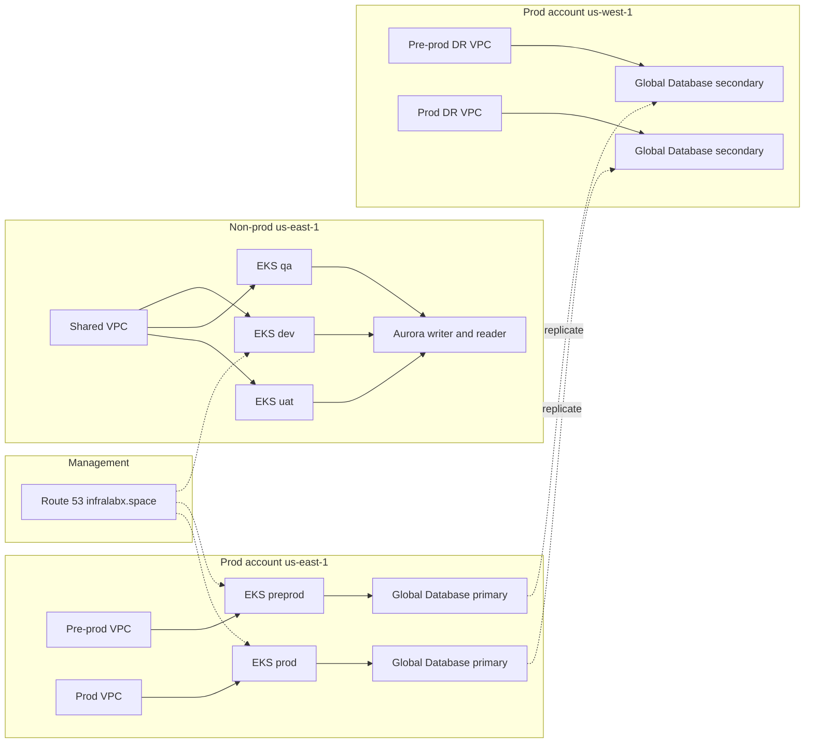

# ShopSphere infrastructure

This repository is the platform. It builds the networks, clusters, databases, edge, and cluster add-ons for ShopSphere. Application code, Helm charts, and image builds live in one repository per service. Argo CD deploys from [shopsphere-gitops](https://github.com/Johnson9393/shopsphere-gitops).

The same Terraform stacks are applied once per environment. Environment differences are var files and separate state keys. The VPC, Aurora, and EKS modules are the only modules.

## Accounts and environments

| Account | ID | Environments | Network | Database |
|---|---|---|---|---|
| Management | `023192525105` | DNS for `infralabx.space` | Public Route 53 zone | None |
| Non-prod | `071138597726` | dev, qa, uat | One shared VPC, `10.0.0.0/16` | One shared Aurora cluster, `nonprod-shopsphere` |
| Prod | `991232066823` | pre-prod, prod | One VPC each, `10.4.0.0/16` and `10.5.0.0/16` | One Aurora Global Database each |

Dev, QA, and UAT each have their own EKS cluster, node group, Redis, Amazon MQ, ECR repositories, secrets, load balancer, and hostname. They share the VPC and the Aurora cluster. Each environment still has its own databases (`dev_products`, `qa_products`, and the same pattern for users, orders, and payments) and its own database login.

Pre-prod is the same shape as prod, on a smaller database class. It is the production rehearsal, not a fourth tenant on the shared non-prod database.

State buckets:

- Non-prod: `shopsphere-tfstate-nonprod-use1`
- Prod account, including the `us-west-1` disaster-recovery stacks: `shopsphere-tfstate-prod-use1`

Create the prod bucket before the first pre-prod apply.

## How the platform is built



### Request path

A shopper uses `https://shop.<env>.infralabx.space`.

1. Route 53 alias sends the name to CloudFront.
2. CloudFront redirects HTTP to HTTPS. `/images/*` is read from a private S3 bucket through an origin access control. `/api/*` and the rest go to the ALB at `origin.<env>.infralabx.space` with caching off.
3. The bucket blocks public access, denies any request that is not TLS, and allows `s3:GetObject` only from that distribution.
4. A CloudFront WAF rate-limits and filters common attacks, known bad inputs, and SQL injection. A regional WAF sits on the ALB. Shield Standard is on. Shield Advanced is off.
5. The AWS Load Balancer Controller creates the ALB from the Ingress. External DNS, assuming `shopsphere-dns` in the management account, writes the origin record. The certificate is `*.<env>.infralabx.space`.
6. The Ingress sends traffic to `api-gateway`. The gateway routes `/api/products`, `/api/users`, `/api/cart`, `/api/orders`, and `/api/payments` to the service for that path.
7. The service reaches Aurora only through RDS Proxy. The proxy requires TLS. The Aurora security group accepts the EKS cluster security group on port 5432.

### What runs on every cluster

Each cluster is `<env>-shopsphere`, Kubernetes 1.35, in two private subnets and two Availability Zones. The node group starts at two `t3.medium` nodes. The cluster autoscaler may grow it. The EBS CSI driver provides encrypted gp3 disks.

On the cluster:

- External Secrets copies Secrets Manager values into Kubernetes. The master database password is Aurora-managed. Each environment login is a separate secret.
- Argo CD in `<env>-argocd` watches `apps/<env>` in the GitOps repository.
- Prometheus, Grafana, and Loki run in `monitoring`. Promtail ships container logs to Loki. Metrics Server feeds the Horizontal Pod Autoscaler.
- CloudWatch and the OpenTelemetry collector keep traces and the application error alarm.
- Reloader restarts a pod when a mounted secret changes.

| Hostname | What it opens |
|---|---|
| `shop.<env>.infralabx.space` | Shop |
| `origin.<env>.infralabx.space` | ALB behind CloudFront |
| `argocd.<env>.infralabx.space` | Argo CD |
| `grafana.<env>.infralabx.space` | Grafana, including Loki |
| `prometheus.<env>.infralabx.space` | Prometheus |
| `loki.<env>.infralabx.space` | Loki API |

Grafana and Argo CD have admin passwords in Kubernetes secrets. Prometheus and Loki are on the same load balancer and the same WAF, and they do not have a separate login.

## High availability, scale, and fault tolerance

Inside one region the platform is highly available and it tolerates the loss of one Availability Zone.

| Layer | What survives a single AZ failure | How it scales |
|---|---|---|
| Network | Public, private, and database subnets in two zones. One NAT gateway per zone. | The VPC is fixed. Pods and nodes scale inside it. |
| EKS | Nodes are spread across both private subnets. A lost node is replaced by the cluster autoscaler. | Node group `min` 2, `max` 4 in the lower environments and pre-prod, `max` 6 in prod. |
| Pods | Two replicas, spread across zones, with a PodDisruptionBudget of `minAvailable: 1`. | HPA adds pods up to 6 when CPU stays above 70 percent. |
| Aurora | Writer and reader in the cluster. Aurora promotes the reader if the writer is lost. | The reader takes read traffic through the proxy reader endpoint. Instance class is the scale limit. |
| RDS Proxy | Sits in both database subnets and pools connections. | Pool cap is 90 percent of database connections. |
| Edge | CloudFront and the ALB are regional or global services in front of the cluster. | CloudFront absorbs cacheable reads. `/api/*` is not cached. |
| Redis and Amazon MQ | Multi-AZ. | Node class is set per environment. |

Dev, QA, and UAT are fault tolerant inside `us-east-1`. They are not a disaster-recovery pair. Losing `us-east-1` takes the shared VPC and the shared database with it. That is a deliberate cost choice for the lower environments.

## Disaster recovery for pre-prod and prod

Pre-prod and prod each have an Aurora Global Database.

- The primary cluster is in `us-east-1`: `preprod-shopsphere` or `prod-shopsphere`. Storage is encrypted with a customer-managed key in that region. Deletion protection is on. Backups are kept for 14 days.
- The secondary cluster is in `us-west-1`: `preprod-shopsphere-dr` or `prod-shopsphere-dr`. It is a reader attached to the same global cluster, in its own VPC (`10.14.0.0/16` or `10.15.0.0/16`), with its own key in `us-west-1`. Aurora replicates the data. The secondary does not create a second master password or a second proxy. The database users already travel with the data.

The pre-prod and prod applies create the primary stacks and then the disaster-recovery network and Aurora secondary. The disaster-recovery EKS, Redis, Amazon MQ, and add-on files are in the repo as `*-dr.tfvars`. They are not applied on the steady-state run. The running clusters stay in `us-east-1`, which is a pilot light: the second region has the network and a live copy of the database, and compute is built there only when the primary region is lost.

Failover, in order:

1. Confirm the primary region is the failed site, not a single pod or node.
2. Promote the `us-west-1` cluster to be the Global Database writer. From this point the old primary is no longer the writer.
3. Apply the disaster-recovery compute stacks against the prod account, in this order, with `<env>` set to `preprod` or `prod`:

```bash
terraform -chdir=infra/core-infra/eks init -backend-config=vars/<env>-dr.tfbackend
terraform -chdir=infra/core-infra/eks apply -var-file=vars/<env>-dr.tfvars

terraform -chdir=infra/app-infra/ecr init -backend-config=vars/<env>-dr.tfbackend
terraform -chdir=infra/app-infra/ecr apply -var-file=vars/<env>-dr.tfvars

terraform -chdir=infra/app-infra/data-services init -backend-config=vars/<env>-dr.tfbackend
terraform -chdir=infra/app-infra/data-services apply -var-file=vars/<env>-dr.tfvars

terraform -chdir=infra/core-infra/k8-services init -backend-config=vars/<env>-dr.tfbackend
terraform -chdir=infra/core-infra/k8-services apply -var-file=vars/<env>-dr.tfvars
```

4. Point the CloudFront origin at the new ALB. The shop name stays `shop.<env>.infralabx.space`.
5. Sync the Argo CD applications. Prod still waits for a person to press Sync.

The recovery point is the Aurora replication lag, usually seconds. The recovery time includes the cluster build, because the second region does not run EKS until this failover. Redis and Amazon MQ are rebuilt empty in the new region. Orders and payments that were only in the queue, and not yet in Aurora, are not part of the database copy.

## Repositories and delivery

| Repository | Job |
|---|---|
| `shopsphere-infra` | This repo. Terraform and the platform workflow. |
| `shopsphere-<service>` | One service: code, Dockerfile, Helm chart, and CI. |
| `shopsphere-gitops` | `values/<env>.yaml` and one Argo CD Application per service per environment. |
| `shopsphere` | The original combined chart and database bootstrap. Argo CD does not install it. |

A service pipeline does not deploy. On a pull request it scans for secrets, runs tests, lints the chart, builds the image, and scans it with Trivy without pushing. After merge to `main` it scans again, pushes one tag to the dev ECR repository, and updates only that service’s `values/dev.yaml` with a short-lived GitHub App token.

Argo CD syncs dev, QA, UAT, and pre-prod on its own. Prod has no automated sync. Promotion past dev is a pull request in the GitOps repository. `@Johnson9393/qa-team` owns the QA and UAT value files. `@Johnson9393/release-team` owns pre-prod and prod.

## How to apply one environment

Run the **ShopSphere Infrastructure** workflow from `main`. Choose `apply` and one environment. Approve that environment when the apply job waits.

Do one environment at a time. Dev, QA, and UAT share the non-prod network and Aurora state, so they share one lock. Pre-prod and prod each have their own lock, and each of those runs also applies its `us-west-1` network and Aurora secondary.

The apply order inside a run is network, ECR, EKS, data services, Aurora, the disaster-recovery network and Aurora for pre-prod and prod, then the cluster add-ons.

Read the plan before you approve it. The first dev apply creates the shared VPC and the shared Aurora cluster as well as the dev cluster. A later QA apply adds the QA cluster and reuses the network and the database.

Destroying dev, QA, or UAT does not destroy the shared VPC or the shared Aurora cluster. Destroying pre-prod or prod removes the disaster-recovery secondary first, then that environment’s primary database and VPC.
