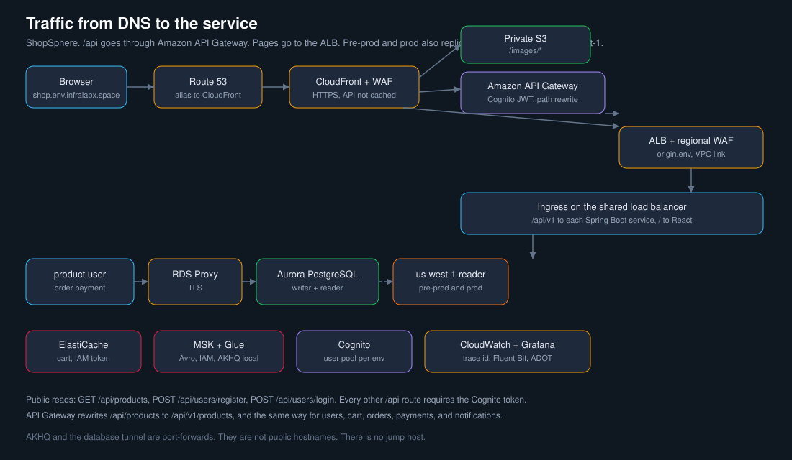
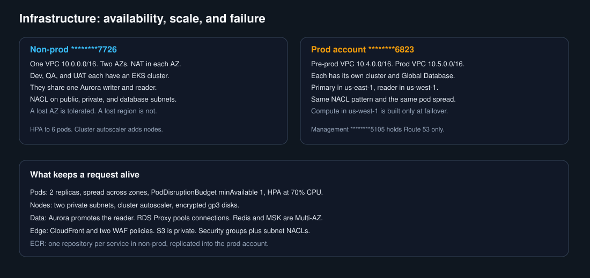
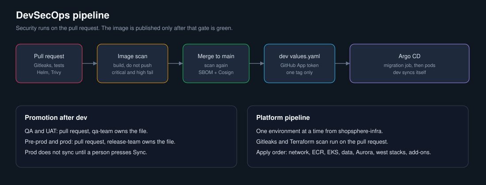
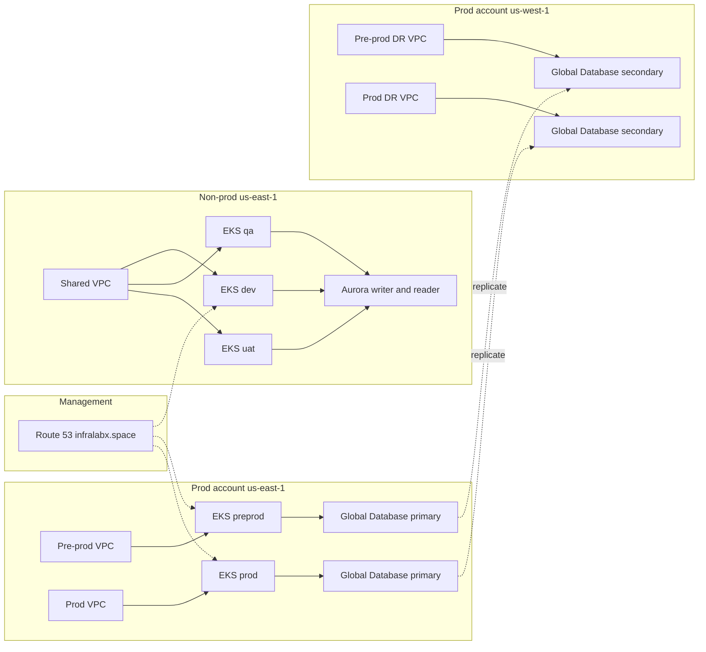
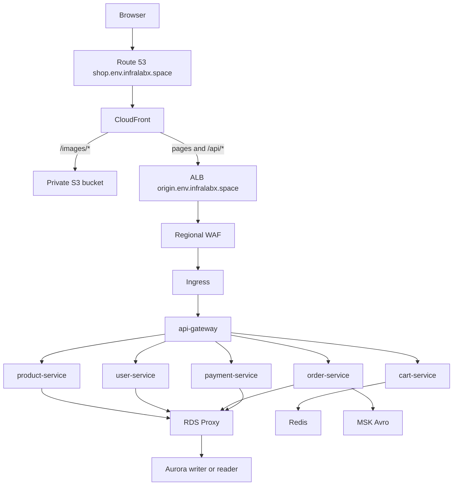

# ShopSphere infrastructure

This repository is the platform. It builds the networks, clusters, databases, edge, and cluster add-ons for ShopSphere. Application code, Helm charts, and image builds live in one repository per service. Argo CD deploys from [shopsphere-gitops](https://github.com/Johnson9393/shopsphere-gitops).

The same Terraform stacks are applied once per environment. Environment differences are var files and separate state keys. The VPC, Aurora, and EKS modules are the only modules.

## Accounts and environments

| Account | ID | Environments | Network | Database |
|---|---|---|---|---|
| Management | `********5105` | DNS for `infralabx.space` | Public Route 53 zone | None |
| Non-prod | `********7726` | dev, qa, uat | One shared VPC, `10.0.0.0/16` | One shared Aurora cluster, `nonprod-shopsphere` |
| Prod | `********6823` | pre-prod, prod | One VPC each, `10.4.0.0/16` and `10.5.0.0/16` | One Aurora Global Database each |

Published docs show the last four digits of an account. `********7726` is non-prod, `********6823` is prod, and `********5105` is management. Image registries in GitOps keep the real registry hostname, because that hostname is the ECR address Argo CD pulls.

Dev, QA, and UAT each have their own EKS cluster, node group, ElastiCache, MSK cluster, Cognito user pool, Glue schema registry, ECR repositories, secrets, load balancer, and hostname. They share the VPC and the Aurora cluster. Each environment still has its own databases (`dev_products`, `qa_products`, and the same pattern for users, orders, and payments) and its own database login. Pre-prod and prod are isolated in the prod account. Each has its own VPC in `us-east-1` and a peered VPC in `us-west-1`.

Pre-prod is the same shape as prod, on a smaller database class. It is the production rehearsal, not a fourth tenant on the shared non-prod database.

State buckets:

- Non-prod: `shopsphere-tfstate-nonprod-use1`
- Prod account, including the `us-west-1` disaster-recovery stacks: `shopsphere-tfstate-prod-use1`

Create the prod bucket before the first pre-prod apply.

## How the platform is built


The drawing above is the platform. It is also saved as [docs/architecture.excalidraw](docs/architecture.excalidraw). Open that file in Excalidraw to move the boxes. The SVG is the same picture, so this README shows it on GitHub.

Non-prod and prod use the same shape. A request enters Route 53, CloudFront, and the ALB, then the gateway pod. Pods are spread across two Availability Zones. Aurora, Redis, and the load balancer fail over inside the region. Pre-prod and prod also replicate Aurora and the image buckets to `us-west-1`. That second region is a pilot light: the database copy is live, and the cluster is built when the primary region is lost.







Open this README and the three pictures are the architecture. The text under them is the runbook.



### Traffic from DNS to the pod

This is the path to show when you explain the running system. One shop name, then the edge, then the cluster, then the database.



A shopper uses `https://shop.<env>.infralabx.space`.

1. Route 53 alias sends the name to CloudFront.
2. CloudFront redirects HTTP to HTTPS. `/images/*` is read from a private S3 bucket through an origin access control. `/api/*` and the rest go to the ALB at `origin.<env>.infralabx.space` with caching off.
3. The bucket blocks public access, denies any request that is not TLS, and allows `s3:GetObject` only from that distribution.
4. A CloudFront WAF rate-limits and filters common attacks, known bad inputs, and SQL injection. A regional WAF sits on the ALB. Shield Standard is on. Shield Advanced is off.
5. The AWS Load Balancer Controller creates the ALB from the Ingress. External DNS, assuming `shopsphere-dns` in the management account, writes the origin record. The certificate is `*.<env>.infralabx.space`.
6. The Ingress sends traffic to `api-gateway`. The gateway routes `/api/products`, `/api/users`, `/api/cart`, `/api/orders`, and `/api/payments` to the service for that path.
7. The service reaches Aurora only through RDS Proxy. The proxy requires TLS. The Aurora security group accepts the EKS cluster security group on port 5432.

### What runs on every cluster

Each cluster is `<env>-shopsphere`, Kubernetes 1.35, in two private subnets and two Availability Zones. The node group starts at two `t3.medium` nodes. The cluster autoscaler may grow it. The EBS CSI driver provides encrypted gp3 disks.

On the cluster:

- External Secrets copies Secrets Manager values into Kubernetes. The master database password is Aurora-managed. Each environment login is a separate secret.
- Argo CD in `<env>-argocd` watches `apps/<env>` in the GitOps repository.
- Prometheus, Grafana, and Loki run in `monitoring`. Promtail ships container logs to Loki. Metrics Server feeds the Horizontal Pod Autoscaler.
- CloudWatch and the OpenTelemetry collector keep traces and the application error alarm.
- Reloader restarts a pod when a mounted secret changes.

| Hostname | What it opens |
|---|---|
| `shop.<env>.infralabx.space` | Shop |
| `origin.<env>.infralabx.space` | ALB behind CloudFront |
| `argocd.<env>.infralabx.space` | Argo CD |
| `grafana.<env>.infralabx.space` | Grafana, including Loki |
| `prometheus.<env>.infralabx.space` | Prometheus |
| `loki.<env>.infralabx.space` | Loki API |

Grafana and Argo CD have admin passwords in Kubernetes secrets. Prometheus and Loki are on the same load balancer and the same WAF, and they do not have a separate login.

The diagram you can open and present is [docs/architecture.excalidraw](docs/architecture.excalidraw), with the rendered view in [docs/architecture.svg](docs/architecture.svg). The services are Spring Boot. The React application is the only frontend. Orders and payments publish Avro events to MSK. Glue Schema Registry holds those contracts. Cognito is the user pool. ElastiCache holds carts and authenticates with IAM. Aurora Global Database, RDS Proxy, Secrets Manager, and the External Secrets Operator are unchanged.

## Images and registries

Non-prod keeps **one ECR repository per service**, named `shopsphere-<service>`. Dev, QA, and UAT pull that same repository. The dev stack owns the repositories and the replication rule. AWS copies each new image into the prod account. The prod stack does not build a second copy. It allows the non-prod account to create the repository there and replicate the image. Pre-prod and prod clusters pull from the prod-account repository of the same name.

The dev image bucket is versioned and replicates new objects into the pre-prod and prod image buckets. Each environment's CloudFront reads only the private bucket in its own account. Prod CloudFront never reads the non-prod bucket.

Apply the pre-prod and prod stacks once so those buckets and the replication permission exist, then apply dev so the replication rule has a destination.

Amazon Inspector enhanced scanning is turned on for those repositories in both accounts, in `us-east-1` and in `us-west-1`. After an image arrives, Inspector scans the operating system and the language packages, and it scans the image again when a new vulnerability is published. The repository still has basic scan on push. Inspector is the scan that covers the stored images. Trivy remains the scan that blocks the push.

The same objects and images are also copied to `us-west-1`. Every environment's image bucket, in both accounts, has a private replica in `us-west-1`. The non-prod ECR rule copies each `shopsphere-<service>` image to `us-west-1` in the non-prod account and to both `us-east-1` and `us-west-1` in the prod account. A new push is what replicates. Images that were pushed before the rule existed are not copied back.

## Secrets

Terraform stores secret names and endpoints. It does not generate the database password. MSK, ElastiCache, and Cognito do not use a password.

| Secret | Who creates the value | Who reads it |
|---|---|---|
| Aurora master | Aurora. State keeps the secret ARN. | The rotation Lambda, to administer logins. |
| `shopsphere/{env}/aurora` and the product, user, order, and payment secrets | The Aurora rotation Lambda. It creates the role, the four databases, and the password, then rotates that password every 7 days. | External Secrets in each service chart. |
| `shopsphere/{env}/cognito` | Terraform. Pool id, client id, and issuer. No password. | User service and the API gateway. |
| `shopsphere/{env}/kafka` | Terraform. IAM bootstrap brokers and the Glue registry name. | Order, payment, and notification pods. |
| `shopsphere/{env}/amazonmq` and `notification-service` | The data Lambda. It replaces the broker's bootstrap password during apply, then rotates the real password every 7 days. | The notification pod. |
| ElastiCache | No password. The cart pod signs a 15-minute IAM token. | Cart service account `cart-service`. |

MSK uses IAM on port 9098. The order and payment services publish Avro with the Glue serializer, and auto-registration is off because Terraform creates the schemas. Cognito `USER_PASSWORD_AUTH` is the only shopper login. The gateway checks the Cognito issuer when that value is present.

External Secrets runs in the cluster and mounts each secret into the service that owns it. Pods do not receive passwords from the image or from a Terraform output.

There is no file-upload path in the application. Product images are a URL stored on the row, not a file the shopper uploads. A virus-scanning Lambda is not part of this platform.

## Subnet NACLs

Security groups still guard the pod, the proxy, Aurora, Redis, and MSK. Each subnet also has a network ACL, which is stateless.

| Subnet | What is allowed |
|---|---|
| Public | Inbound 80 and 443 from the internet, return traffic, and the VPC. Used by the load balancer and NAT. |
| Private | Traffic inside the VPC, plus HTTPS out through NAT so nodes can pull images and call AWS. |
| Database | Postgres 5432 from the VPC only, plus the replies and HTTPS out for Aurora's own AWS calls. |

Anything else is denied at the subnet. A security group cannot open a path the NACL has already dropped.

## MSK

The brokers are private. Dev, QA, and UAT have one cluster in `us-east-1`. Pre-prod and prod also run a cluster in `us-west-1`. An MSK replicator copies `shopsphere.*` topics across the VPC peering connection while the primary region is healthy. There is no broker password and no management console to tunnel.

## Database login from DBeaver

Each environment has its own username and password in `shopsphere/<env>/aurora`, encrypted with the Aurora KMS key. The database services also have `shopsphere/<env>/<service>` with that same login and the database that service owns.

```bash
export AWS_PROFILE=nonprod-admin
./scripts/db-tunnel.sh dev
```

Use `qa` or `uat` the same way. For pre-prod and prod, export the prod account profile and pass `preprod` or `prod`. The script prints localhost, the local port, the username, the password, and the four database names. In DBeaver the host is `localhost`. Leave the terminal open while you work.

## Schema changes

Product, user, order, and payment are Spring Boot and run Flyway. The chart starts `java -jar /app/app.jar --shopsphere.migrate-only=true` as an Argo CD PreSync job. The Deployment rolls only after the job succeeds. A failed migration leaves the previous pods in place. Cart, notification, the gateway, and the React frontend have no tables.

Cart stores its data in Redis and has no SQL migration. Notification consumes the queue and has no SQL migration. The API gateway and the frontend have no database. A product-service change that adds a column therefore migrates `*_products` before the new product pods start. The other services are unchanged.

## High availability, scale, and fault tolerance

Inside one region the platform is highly available and it tolerates the loss of one Availability Zone.

| Layer | What survives a single AZ failure | How it scales |
|---|---|---|
| Network | Public, private, and database subnets in two zones. One NAT gateway per zone. | The VPC is fixed. Pods and nodes scale inside it. |
| EKS | Nodes are spread across both private subnets. A lost node is replaced by the cluster autoscaler. | Node group `min` 2, `max` 4 in the lower environments and pre-prod, `max` 6 in prod. |
| Pods | Two replicas, spread across zones, with a PodDisruptionBudget of `minAvailable: 1`. | HPA adds pods up to 6 when CPU stays above 70 percent. |
| Aurora | Writer and reader in the cluster. Aurora promotes the reader if the writer is lost. | The reader takes read traffic through the proxy reader endpoint. Instance class is the scale limit. |
| RDS Proxy | Sits in both database subnets and pools connections. | Pool cap is 90 percent of database connections. |
| Edge | CloudFront and the ALB are regional or global services in front of the cluster. | CloudFront absorbs cacheable reads. `/api/*` is not cached. |
| Redis and MSK | Multi-AZ. Two brokers, one in each private subnet. | Node class is set per environment. |

Dev, QA, and UAT are fault tolerant inside `us-east-1`. They are not a disaster-recovery pair. Losing `us-east-1` takes the shared VPC and the shared database with it. That is a deliberate cost choice for the lower environments.

## Disaster recovery for pre-prod and prod

Pre-prod and prod each have an Aurora Global Database.

- The primary cluster is in `us-east-1`: `preprod-shopsphere` or `prod-shopsphere`. Storage is encrypted with a customer-managed key in that region. Deletion protection is on. Backups are kept for 14 days.
- The secondary cluster is in `us-west-1`: `preprod-shopsphere-dr` or `prod-shopsphere-dr`. It is a reader attached to the same global cluster, in its own VPC (`10.14.0.0/16` or `10.15.0.0/16`), with its own key in `us-west-1`. Aurora replicates the data. The secondary does not create a second master password or a second proxy. The database users already travel with the data.

The pre-prod and prod applies create the primary stacks, then the `us-west-1` network, the MSK cluster with its replicator, and the Aurora secondary. The west EKS cluster is still built at failover. The west network is peered to the east network so the replicator can reach both clusters while the east region is healthy. Dev, QA, and UAT stay in one region and do not peer.

Failover, in order:

1. Confirm the primary region is the failed site, not a single pod or node.
2. Promote the `us-west-1` cluster to be the Global Database writer. From this point the old primary is no longer the writer.
3. Apply the disaster-recovery compute stacks against the prod account, in this order, with `<env>` set to `preprod` or `prod`:

```bash
terraform -chdir=infra/core-infra/eks init -backend-config=vars/<env>-dr.tfbackend
terraform -chdir=infra/core-infra/eks apply -var-file=vars/<env>-dr.tfvars

terraform -chdir=infra/app-infra/ecr init -backend-config=vars/<env>-dr.tfbackend
terraform -chdir=infra/app-infra/ecr apply -var-file=vars/<env>-dr.tfvars

terraform -chdir=infra/app-infra/data-services init -backend-config=vars/<env>-dr.tfbackend
terraform -chdir=infra/app-infra/data-services apply -var-file=vars/<env>-dr.tfvars

terraform -chdir=infra/core-infra/k8-services init -backend-config=vars/<env>-dr.tfbackend
terraform -chdir=infra/core-infra/k8-services apply -var-file=vars/<env>-dr.tfvars
```

4. Point the CloudFront origin at the new ALB. The shop name stays `shop.<env>.infralabx.space`.
5. Sync the Argo CD applications. Prod still waits for a person to press Sync.

The recovery point is the Aurora replication lag, usually about a second, plus the MSK replication lag for events. That is not a point-in-time restore. Point-in-time restore rewinds a cluster that is still up. Redis is rebuilt empty. Orders that were committed to Aurora are on the west reader. Events that the replicator already copied are on the west MSK cluster.

## Repositories and delivery

| Repository | Job |
|---|---|
| `shopsphere-infra` | This repo. Terraform and the platform workflow. |
| `shopsphere-<service>` | One service: code, Dockerfile, Helm chart, and CI. |
| `shopsphere-gitops` | `values/<env>.yaml` and one Argo CD Application per service per environment. |
| `shopsphere` | The original combined chart and database bootstrap. Argo CD does not install it. |

A service pipeline does not deploy. The pipeline is DevSecOps: it blocks a bad change before the image exists in the registry.

| Check | When it runs | What it stops |
|---|---|---|
| Gitleaks | Every pull request and every merge | A secret committed in Git |
| Tests | Every pull request and every merge | A broken build of that service |
| Helm lint | Every pull request and every merge | A chart that will not render |
| SonarQube | Every pull request and every merge | Bugs, vulnerabilities, and code smells above the quality gate |
| Trivy filesystem | Every pull request and every merge | A known critical or high vulnerability in dependencies, and a leaked secret in the tree |
| Trivy image | Pull request, without push. Merge, before push | A known critical or high vulnerability in the image |
| Amazon Inspector | After the image is in ECR, both regions, both accounts | A new vulnerability in an image that is already stored |
| SBOM | After the image scan on `main`, saved as a workflow artifact | A release with no inventory of components |
| Cosign | After the push on `main` | An unsigned image tag |

After those checks pass, the workflow pushes one tag to the dev ECR repository and updates only that service’s `values/dev.yaml` with a short-lived GitHub App token. The platform repository runs the same secret scan on every pull request, plus a Trivy configuration scan of the Terraform.

Argo CD syncs dev, QA, UAT, and pre-prod on its own. Prod has no automated sync. Promotion past dev is a pull request in the GitOps repository. `@Johnson9393/qa-team` owns the QA and UAT value files. `@Johnson9393/release-team` owns pre-prod and prod.

## How to execute each environment

Run the **ShopSphere Infrastructure** workflow from `main`. Choose `apply` and one environment. Read the plan. Approve that GitHub environment when the apply job waits. Finish one environment and check it before you start the next.

The stacks inside a run are always in this order: network, ECR, EKS, data services, Aurora, then the cluster add-ons. Pre-prod and prod then apply the `us-west-1` network, the west data services, and the Aurora secondary.

Dev, QA, and UAT share the non-prod network and Aurora state, so only one of those three runs at a time. Pre-prod and prod each have their own lock.

### Dev

1. Apply `dev` in the non-prod account.
2. This first run creates the shared VPC, the shared Aurora cluster, and the `dev-shopsphere` cluster. It does not create the QA or UAT clusters.
3. Open `https://argocd.dev.infralabx.space`, `https://grafana.dev.infralabx.space`, and `https://shop.dev.infralabx.space`.
4. In Argo CD, confirm the applications under `apps/dev` are Healthy. Dev syncs by itself when a service pipeline updates `values/dev.yaml`.

### QA

1. Apply `qa` only after dev is up. The run reuses the VPC and Aurora and creates `qa-shopsphere`.
2. Promote a build by pull request in the GitOps repository. Change that service’s `values/qa.yaml` to the image tag that is already running in dev. `@Johnson9393/qa-team` approves it.
3. Argo CD syncs QA. Check `https://shop.qa.infralabx.space` and `https://argocd.qa.infralabx.space`.

### UAT

1. Apply `uat` after QA is up. Same shared VPC and Aurora, new cluster `uat-shopsphere`.
2. Promote with a pull request to `values/uat.yaml`, owned by the same QA team.
3. Check `https://shop.uat.infralabx.space`.

### Pre-prod

1. Apply `preprod` in the prod account. The state bucket `shopsphere-tfstate-prod-use1` must already exist.
2. The run creates the pre-prod VPC, cluster, and Aurora Global Database primary in `us-east-1`, then the disaster-recovery VPC and Aurora reader in `us-west-1`.
3. Promote with a pull request to `values/preprod.yaml`. `@Johnson9393/release-team` approves it.
4. Argo CD syncs pre-prod. Check `https://shop.preprod.infralabx.space`. Treat this as the production rehearsal.

### Prod

1. Apply `prod` after pre-prod is understood. It creates the prod VPC, cluster, and Global Database primary, then the `us-west-1` reader.
2. Promote with a pull request to `values/prod.yaml`. The release team approves it.
3. Open `https://argocd.prod.infralabx.space` and press Sync. Prod does not sync itself.
4. Check `https://shop.prod.infralabx.space`.

Destroying dev, QA, or UAT does not destroy the shared VPC or the shared Aurora cluster. Destroying pre-prod or prod removes the disaster-recovery secondary first, then that environment’s primary database and VPC.
